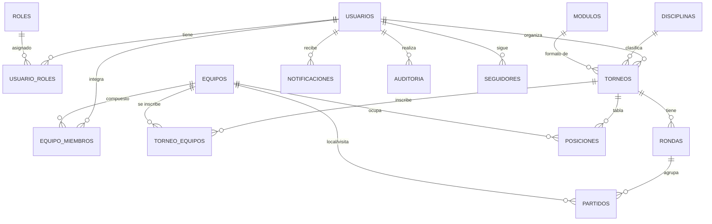

# Manual técnico — TriunfoTotal (SGDM)

**Sistema de Gestión Deportiva Modular** · ByteCraft · 3° MO Nocturno · ITS Arias-Balparda · 2026

---

## 1. Arquitectura general

TriunfoTotal es una aplicación web *full stack* organizada según el patrón **Modelo-Vista-Controlador (MVC)**:

```
 Navegador (React)                     Servidor (Docker)
┌──────────────────┐   HTTPS/JSON   ┌───────────────────────────────────────────────────────┐
│  VISTA           │ ─────────────► │  Apache 2.4 + PHP 8.1  (contenedor triunfo_web)       │
│  React + Vite    │                │                                                       │
│  Bootstrap 5     │                │  api/index.php  ← FRONT CONTROLLER (único punto PHP)  │
│  Redux (sesión)  │ ◄───────────── │      │                                                │
└──────────────────┘                │      ▼                                                │
                                    │  Router ─► CONTROLADOR ─► MODELO ─► PDO ──────────┐   │
                                    │            (valida,       (SQL     (consultas     │   │
                                    │             permisos)      preparado) preparadas) │   │
                                    │                 │                                 │   │
                                    │                 ▼                                 │   │
                                    │        MÓDULOS DE COMPETENCIA                     │   │
                                    │        Liga · Eliminación · Suizo                 │   │
                                    └───────────────────────────────────────────────────┼───┘
                                                                     red interna Docker │
                                    ┌───────────────────────────────────────────────────▼───┐
                                    │  MariaDB 10.6 (contenedor triunfo_db)                 │
                                    │  tablas · vistas · triggers · procedimientos          │
                                    └───────────────────────────────────────────────────────┘
```

| Capa | Responsabilidad | Dónde está |
|---|---|---|
| **Vista** | Mostrar información y capturar datos del usuario. Valida en el frontend para dar respuesta inmediata. | `src/` (React) |
| **Controlador** | Recibir la petición, validar datos y permisos, coordinar la lógica y responder JSON. No contiene SQL ni HTML. | `app/controllers/` |
| **Modelo** | Representar las entidades y ser el **único** que habla con la base de datos. | `app/models/` |
| **Módulos de competencia** | Lógica propia de cada formato de torneo, intercambiable. | `app/modulos/` |
| **Núcleo** | Router, sesión, validación, respuestas y manejo centralizado de errores. | `app/core/` |

### Flujo de una petición (ejemplo: cargar un resultado)

1. React ejecuta `api.put("partidos/42", { goles_local: 2, goles_visita: 1 })`.
2. Apache recibe `PUT /api/partidos/42` y lo envía a `api/index.php`.
3. `App::ejecutar()` agrega cabeceras de seguridad, controla el origen (CSRF), inicia la sesión e indica a la base quién está operando (`SET @app_id_usuario`).
4. El `Router` encuentra la ruta `partidos/{id}` → `CompetenciaController::actualizarPartido(42)`.
5. El controlador verifica que el usuario sea el **organizador** del torneo (o admin), valida los datos con `Validador` y consulta al módulo si se permiten empates.
6. `Partido::guardarResultado()` ejecuta el `UPDATE` con una sentencia preparada.
7. En la base, el trigger `trg_partidos_au` **registra la auditoría** y llama a `sp_recalcular_posiciones` para actualizar la tabla.
8. Se responde `{"ok": true, "data": {...}}` y React refresca la pantalla.

Si cualquier paso falla, se lanza una `HttpError` (por ejemplo, 403) y el manejador central de `App.php` la convierte en `{"ok": false, "error": "..."}` con el código HTTP correcto. Los errores internos se registran en el log del servidor y **nunca** se muestran al usuario.

---

## 2. Estructura de carpetas

```
TriunfoTotal/
├── api/
│   ├── index.php            Front controller: único PHP accesible desde la web
│   └── .htaccess            Redirige /api/<ruta> a index.php (Apache local)
├── app/                     Backend (fuera de la carpeta pública)
│   ├── core/                App, Router, Controlador, Modelo, Sesion, Validador, Respuesta, HttpError
│   ├── controllers/         Auth, Perfil, Catalogo, Torneo, Inscripcion, Competencia, Equipo, Notificacion, Admin
│   ├── models/              Usuario, Torneo, Equipo, Inscripcion, Ronda, Partido, Posicion, Notificacion,
│   │                        Auditoria, Catalogo, IntentoLogin
│   ├── modulos/             ModuloCompetencia (abstracto), ModuloLiga, ModuloEliminacion, ModuloSuizo
│   └── rutas.php            Mapa completo de rutas de la API
├── config/
│   ├── Conexion.php         Conexión PDO (Singleton). Sin contraseñas: las toma del entorno
│   └── config.local.php     Credenciales locales (NO se sube a git)
├── database/
│   ├── 01_esquema.sql       DDL: tablas, claves, restricciones, vistas, catálogos
│   ├── 02_datos_prueba.sql  Datos de prueba (+50 registros por componente)
│   ├── 03_logica.sql        Procedimientos y triggers (aprobación, posiciones, auditoría)
│   ├── 04_dcl.sh            DCL: usuarios de la base con mínimo privilegio
│   ├── generar_datos_prueba.php   Genera los datos de prueba usando los modelos reales
│   └── exportar_datos_prueba.sh   Exporta esos datos a 02_datos_prueba.sql
├── docker/web/              Dockerfile, configuración de Apache, php.ini y entrypoint
├── docker-compose.yml       Orquestación: web + base de datos (+ Netdata opcional)
├── scripts/                 Scripts de administración del servidor (bash, Ubuntu Server)
├── src/                     Frontend React
│   ├── components/          Páginas (Tournaments, TournamentDetail, GestionarTorneo, AdminPanel…)
│   │   └── partials/        Componentes reutilizables (Navbar, Llave, TablaPosiciones, TorneoCard…)
│   ├── services/api.js      Único punto de comunicación con el backend
│   ├── redux/               Estado global (usuario logueado)
│   ├── utils/               Formato de fechas/estados, enmascarado de datos sensibles
│   └── css/                 styles.css (maquetado original) + app.css (pantallas nuevas)
├── tests/prueba_api.sh      80 pruebas funcionales automáticas de la API
└── docs/                    Esta documentación
```

---

## 3. Modelo de base de datos

### 3.1 Diagrama entidad-relación (simplificado)



### 3.2 Tablas

| Tabla | Entidad de la letra | Descripción |
|---|---|---|
| `usuarios` | Usuario | Cuenta, perfil y estado (Activo/Baneado). La contraseña se guarda como hash bcrypt. |
| `roles`, `usuario_roles` | Rol | **Roles dinámicos**: Administrador y Usuario (relación N a N). |
| `disciplinas` | Tipo de torneo | Fútbol, Ajedrez, eSports… con su categoría (Deporte, Mental, Electrónico). |
| `modulos` | Módulo de competencia | Liga, Eliminación, Suizo. El admin puede habilitarlos o deshabilitarlos. |
| `torneos` | Torneo + Configuración | Formato, modalidad, tipo (Formal/Informal), puntos, ida y vuelta, fechas, estado, aprobación, campeón. |
| `equipos`, `equipo_miembros` | Equipo / Participante | Un participante individual es un equipo con `es_individual = 1` y un único miembro. |
| `equipo_invitaciones` | Invitación | El capitán invita y la persona acepta o rechaza (Pendiente / Aceptada / Rechazada / Cancelada). Solo al aceptar pasa a `equipo_miembros`. |
| `torneo_equipos` | Inscripción | Pendiente / Aceptada / Rechazada. |
| `rondas` | Ronda | Jornada de liga, fase de eliminación o ronda suiza. Abierta/Cerrada. |
| `partidos` | Enfrentamiento + Resultado | `id_equipo_visita = NULL` indica un BYE (pasa directo). |
| `posiciones` | Tabla de posiciones | La calcula la base (procedimiento), nunca se escribe a mano. |
| `auditoria` | Registro de actividad | Todo INSERT/UPDATE/DELETE + logins, con usuario, IP y fecha. |
| `notificaciones` | — | Avisos internos (campanita). |
| `seguidores` | — | Quién sigue a quién. Cuando un organizador publica un torneo, se avisa a todos sus seguidores con un solo `INSERT … SELECT`. |
| `intentos_login` | — | Protección contra fuerza bruta. |

**Normalización:** el modelo está en 3FN. Por ejemplo, el deporte pasó de ser texto libre (`torneos.deporte`) a una tabla `disciplinas`, y los roles salieron de la columna `es_admin` a la relación `usuario_roles`.

**Restricciones de integridad:** claves foráneas con `ON DELETE CASCADE / SET NULL` según el caso, `UNIQUE` (email, alias, rol), `CHECK` (cantidad de participantes 2-128, fecha fin ≥ inicio, goles ≥ 0).

### 3.3 Vistas

- `v_torneos_publicos`: torneo + disciplina + organizador + cantidad de inscriptos (la usa el listado público).
- `v_posiciones`: posiciones con el nombre del equipo.

### 3.4 Lógica en la base (03_logica.sql)

| Objeto | Qué hace |
|---|---|
| `trg_torneos_before_insert` | Torneo **Informal** → se aprueba solo. **Formal** → queda Pendiente. Rechaza torneos de módulos deshabilitados. |
| `trg_torneos_before_update` | Si un torneo pasa a Formal, vuelve a requerir aprobación del admin. |
| `sp_recalcular_posiciones(id)` | Recalcula **desde cero** la tabla de posiciones con los puntos configurados en el torneo. Corregir un resultado nunca duplica puntos. |
| `trg_partidos_ai / _au` | Al cargar o corregir un resultado, recalcula las posiciones. |
| `sp_auditar` + 20 triggers | Registran en `auditoria` cada cambio de usuarios, roles, torneos, equipos, inscripciones, rondas, partidos y módulos. |

### 3.5 DCL (usuarios de la base)

| Usuario | Uso | Permisos |
|---|---|---|
| `app_triunfototal` | La aplicación PHP | SELECT/INSERT/UPDATE/DELETE solo en tablas de negocio; en `auditoria` **solo** SELECT e INSERT; EXECUTE del procedimiento. Sin DROP, ALTER ni GRANT. Máximo 50 conexiones. |
| `backup_triunfototal` | Respaldos | Lectura + LOCK TABLES, SHOW VIEW, TRIGGER. |
| `reportes_triunfototal` | Consultas y monitoreo | Solo lectura + PROCESS. |
| `dba_triunfototal` | Administrador humano | Todo sobre esta base, nada sobre el resto del servidor. |

---

## 4. Módulos del sistema

| # | Módulo (letra 4.3) | Backend | Frontend |
|---|---|---|---|
| 1 | Usuarios y autenticación | `AuthController`, `PerfilController`, `Usuario`, `Sesion` | Login, Register, Profile |
| 2 | Participantes y equipos | `EquipoController`, `Equipo` | MisEquipos |
| 3 | Torneos | `TorneoController`, `InscripcionController` | CrearTorneo, GestionarTorneo |
| 4 | Liga | `ModuloLiga` | Fixture + Tabla |
| 5 | Eliminación directa | `ModuloEliminacion` | Llave |
| 6 | Sistema suizo | `ModuloSuizo` | Rondas + Tabla |
| 7 | Resultados | `CompetenciaController`, `Partido`, `Posicion` | GestionarTorneo (PartidoEditor) |
| 8 | Consulta pública | `TorneoController::listar/detalle` | Home, Tournaments, TournamentDetail |
| 9 | Administración del sistema | `AdminController` | AdminPanel |

### 4.1 Módulos de competencia

Todos heredan de la clase abstracta `ModuloCompetencia`, que define el contrato `iniciar()` y `siguientePaso()`. El controlador obtiene el módulo con la fábrica `ModuloCompetencia::para($formato)` sin conocer sus detalles: así se logra **bajo acoplamiento**, y agregar un formato nuevo (por ejemplo, grupos + playoffs) no obliga a tocar el resto.

**Liga — método del círculo (round robin)**
- Se fija el primer equipo y los demás "rotan" una posición en cada jornada.
- Con *n* equipos se generan *n − 1* jornadas (o *n* si son impares: cada jornada uno descansa).
- Con ida y vuelta se duplican las jornadas invirtiendo la localía.
- El torneo termina cuando se cierran todas las jornadas. El campeón es el primero de la tabla.

**Eliminación directa**
- La llave se completa hasta la siguiente potencia de 2. Con 5 equipos la llave es de 8, y 3 equipos reciben **BYE** (pasan directo).
- Al cerrar una ronda se emparejan los ganadores en orden (ganador 1 vs ganador 2, etc.).
- No se permiten empates. El campeón es el ganador de la final.

**Sistema suizo**
- Se juegan ⌈log₂(n)⌉ rondas (o las que elija el organizador, con un máximo de n − 1).
- La ronda 1 es por sorteo. Desde la segunda, se ordena por puntos y se empareja a cada uno con el rival más cercano **con el que todavía no jugó**, usando *backtracking*.
- Si son impares, el último de la tabla que todavía no descansó recibe un BYE, que cuenta como victoria.

### 4.2 Roles dinámicos (decisión de diseño)

La letra propone un rol fijo "Organizador". Se decidió en cambio que **cualquier usuario registrado puede organizar**:

- **Organizador** no es un rol global: es ser el dueño (`torneos.id_organizador`) de *ese* torneo. Un mismo usuario puede organizar un torneo y participar en otro.
- Torneo **informal**: se publica al instante.
- Torneo **formal**: queda pendiente hasta que un **Administrador** lo aprueba o lo rechaza con un motivo.
- Los permisos se verifican en cada petición: `Sesion::exigirLogin()`, `Sesion::exigirAdmin()` y `TorneoController::puedeGestionar($torneo)`.

| Acción | Público | Usuario | Organizador (de ese torneo) | Admin |
|---|:-:|:-:|:-:|:-:|
| Ver torneos aprobados, fixture, tablas | ✔ | ✔ | ✔ | ✔ |
| Crear torneo / equipo, inscribirse | | ✔ | ✔ | ✔ |
| Aceptar inscripciones, iniciar, cargar resultados, cerrar rondas | | | ✔ | ✔ |
| Corregir resultados de una ronda cerrada | | | | ✔ |
| Aprobar torneos formales, banear, asignar roles, módulos, auditoría | | | | ✔ |

---

## 5. API REST

Todas las respuestas son JSON con el formato `{ ok, data }` o `{ ok: false, error, detalles }`. El mapa completo de rutas está en `app/rutas.php`.

| Método | Ruta | Descripción | Acceso |
|---|---|---|---|
| POST | `/api/auth/registro` | Crear cuenta (inicia sesión) | Público |
| POST | `/api/auth/login` · `/auth/logout` | Iniciar / cerrar sesión | Público |
| GET | `/api/auth/sesion` | Usuario actual (o null) | Público |
| POST | `/api/auth/verificar` · `/auth/reenviar-verificacion` | Confirmar el email con el token del link / pedir otro mail | Público |
| PUT | `/api/perfil` · `/perfil/password` | Editar perfil / cambiar contraseña | Usuario |
| GET | `/api/perfil/torneos` | Torneos que organizo y en los que participo | Usuario |
| GET | `/api/disciplinas` · `/api/modulos` | Catálogos | Público |
| GET | `/api/torneos?q=&formato=&…` | Búsqueda pública | Público |
| GET | `/api/torneos/{id}` | Detalle completo (rondas, partidos, posiciones, permisos) | Público* |
| POST/PUT/DELETE | `/api/torneos[/{id}]` | Crear / editar / eliminar | Usuario / Organizador |
| POST | `/api/torneos/{id}/inscripciones` | Inscribirse o inscribir (directo) | Usuario / Organizador |
| PUT/DELETE | `/api/torneos/{id}/inscripciones/{equipo}` | Aceptar/rechazar · retirar | Organizador / Capitán |
| POST | `/api/torneos/{id}/iniciar` | Genera los enfrentamientos | Organizador |
| PUT | `/api/partidos/{id}` | Cargar resultado o programar fecha | Organizador |
| POST | `/api/rondas/{id}/cerrar` | Cierra la ronda y avanza el torneo | Organizador |
| GET/POST/PUT/DELETE | `/api/equipos…` | Equipos, miembros e invitaciones enviadas | Usuario / Capitán |
| GET/PUT | `/api/invitaciones[/{equipo}]` | Invitaciones recibidas: ver, aceptar o rechazar | Usuario (solo las propias) |
| GET | `/api/usuarios?q=` · `/api/usuarios/{id}` | Buscar personas · perfil público (sin email ni teléfono) | Público |
| POST/DELETE | `/api/usuarios/{id}/seguir` | Seguir / dejar de seguir | Usuario |
| GET | `/api/perfil/seguidos` | A quiénes sigo | Usuario |
| GET/PUT | `/api/notificaciones…` | Notificaciones | Usuario |
| GET/PUT | `/api/admin/…` | Estadísticas, aprobación, usuarios, módulos, auditoría (+CSV) | Admin |

\* Los torneos formales no aprobados solo los ven su organizador y los administradores.

---

## 6. Instalación

### 6.1 Con Docker (recomendado, en Ubuntu Server)

```bash
git clone <repositorio> && cd TriunfoTotal
sudo ./scripts/instalar.sh
```

El instalador instala Docker, crea el `.env` con contraseñas aleatorias, levanta los contenedores, programa respaldos y monitoreo y, opcionalmente, endurece el servidor.

Instalación manual:

```bash
cp .env.example .env                  # completar las contraseñas
docker compose up -d --build          # web + base de datos
docker compose --profile monitoreo up -d   # (opcional) Netdata
```

La aplicación queda en `https://<servidor>`. Hay 5 administradores de prueba: `admin@triunfototal.com` / `Admin1234`, `pablo.admin@` / `PabloAdmin1234`, `micaela.admin@` / `MicaAdmin1234`, `federico.admin@` / `FedeAdmin1234` y `claudio.admin@` / `ClaudioAdmin1234` (todos `@triunfototal.com`). El resto de los usuarios de prueba usa `Prueba1234`.

### 6.2 Configuración de Docker

| Servicio | Imagen | Red | Puertos | Volúmenes |
|---|---|---|---|---|
| `db` | mariadb:10.6 | `red_datos` (interna, sin salida) | **ninguno** publicado | `db_data` (datos), scripts de `database/` en `/docker-entrypoint-initdb.d` |
| `web` | build propio (node → php:8.1-apache) | `red_web` + `red_datos` | 80 → redirige a 443, 443 (HTTPS) | `ssl_certs`, `logs/apache` |
| `netdata` (opcional) | netdata/netdata | `red_web` | 127.0.0.1:19999 | /proc, /sys (solo lectura) |

- **Imagen web en dos etapas:** la primera etapa (Node) compila React; la imagen final solo contiene Apache, PHP y los archivos compilados.
- **Variables de entorno:** las credenciales llegan a PHP por variables de entorno (`DB_HOST`, `DB_USER`, `DB_PASS`…), nunca escritas en el código.
- La base se inicializa sola la primera vez (esquema → datos → lógica → DCL). Para reinstalarla desde cero: `docker compose down -v && docker compose up -d`.
- **Healthchecks:** la web espera a que la base esté sana para arrancar, y Docker reinicia los contenedores si se caen (`restart: unless-stopped`).

### 6.3 Desarrollo local (sin Docker)

1. Importar `database/01_esquema.sql`, `02_datos_prueba.sql` y `03_logica.sql` en MariaDB, y ejecutar `sudo APP_DB_PASS=... BACKUP_DB_PASS=... DB_HOST_PERMITIDO=localhost ./database/04_dcl.sh`.
2. Copiar `config/config.local.php.example` a `config/config.local.php` y completarlo.
3. Hacer que Apache sirva la carpeta `api/` en `http://localhost/api`.
4. Ejecutar `npm install` y `npm run dev`. Vite redirige `/api` a Apache con un proxy (ver `vite.config.js`), así que no hacen falta configuraciones de CORS.

### 6.4 Verificación de email (correo)

Al registrarse, el sistema comprueba que el **dominio** del email reciba correo (registro **MX** del DNS) y, si el envío de correos está activo, manda un **link de verificación**: hasta tocarlo, la cuenta no puede iniciar sesión.

| Variable (`.env` o `config.local.php`) | Valor |
|---|---|
| `CORREO_MODO` | `ninguno` (por defecto: sin verificación, sirve sin internet) · `smtp` (envía de verdad) · `archivo` (guarda los mails en `logs/apache/correos`, para pruebas) |
| `SMTP_USUARIO` | `bytecraftsoftware.2026@gmail.com` |
| `SMTP_CLAVE` | **Contraseña de aplicación** de Google (16 letras, sin espacios), no la contraseña de la cuenta |
| `SMTP_HOST` / `SMTP_PUERTO` | `smtp.gmail.com` / `587` (STARTTLS) |
| `APP_URL` | Dirección pública para el link del mail. Vacía = se toma de la página desde donde se registró. |
| `VALIDAR_DOMINIO_EMAIL` | `true` (rechaza dominios sin MX). Si el servidor no tiene internet, no bloquea a nadie. |

**Cómo obtener la contraseña de aplicación de Gmail:**

1. Entrar a la cuenta del proyecto y activar la **Verificación en 2 pasos** (Cuenta de Google → Seguridad).
2. Ir a **myaccount.google.com/apppasswords**, crear una con el nombre "TriunfoTotal" y copiar las 16 letras.
3. Ponerlas en `SMTP_CLAVE` (sin espacios) y cambiar `CORREO_MODO=smtp`.
4. En Docker: `docker compose up -d` (recrea el contenedor web con la configuración nueva).

**Implementación:**

- `app/core/Correo.php` es un cliente SMTP propio, sin librerías externas: EHLO → STARTTLS (cifrado TLS) → AUTH LOGIN → MAIL FROM / RCPT TO → DATA. El mail es MIME con una versión de texto y otra HTML, y los acentos codificados en base64.
- El token es aleatorio (`random_bytes(32)`, 64 caracteres hexadecimales). En la base se guarda **solo su hash SHA-256**, vence a las 24 h y se borra al usarse.
- Reenviar el mail está limitado a una vez por minuto, y la respuesta es siempre la misma (no revela qué emails están registrados).
- Si un mail no llega, un administrador puede verificar la cuenta a mano desde **Admin → Usuarios**.

### 6.5 Pruebas

```bash
BASE=https://localhost/api ./tests/prueba_api.sh
```

```bash
BASE=https://localhost/api CORREO_CARPETA=$PWD/logs/apache/correos ./tests/prueba_verificacion_email.sh
```

El segundo script prueba el flujo de verificación (requiere `CORREO_MODO=archivo`): 13 pruebas de registro, link, reutilización del token, reenvío limitado y verificación manual del admin.

El primero ejecuta 80 pruebas funcionales de punta a punta (con `CORREO_MODO=ninguno`):

- registro, validaciones y permisos;
- aprobación de torneos formales;
- liga, eliminación y suizo completos hasta el campeón, verificando las reglas de cada formato;
- baneo, bloqueo por fuerza bruta, protección CSRF y auditoría.

---

## 7. Scripts de administración

Ver detalle en `docs/sistemas_operativos.md`.

| Script | Función |
|---|---|
| `instalar.sh` | Instalación completa en Ubuntu Server |
| `gestion_servidor.sh` | **Menú general** que reúne todas las tareas |
| `gestion_usuarios.sh` | Alta, baja, bloqueo y grupos de usuarios del sistema operativo; política de contraseñas |
| `respaldo.sh` | Respaldos cifrados, hasheados y firmados, con rotación, restauración y cron |
| `monitoreo.sh` | Recursos, servicios, contenedores, API, certificado y ataques, con alertas |
| `consultas_bd.sh` | Estado, tamaños, conexiones, auditoría, seguridad, integridad y CSV de la base |
| `seguridad_servidor.sh` | Firewall UFW, fail2ban, SSH, ClamAV, sysctl y actualizaciones automáticas |

---

## 8. Decisiones técnicas

| Decisión | Motivo |
|---|---|
| **React** en el frontend (en lugar de HTML/JS puro) | Componentes reutilizables y una SPA más fluida. Sigue siendo HTML, CSS y JavaScript, que es lo que pide la letra. |
| **API REST JSON** + front controller | Separa por completo la vista (React) del backend. Las rutas son claras y los permisos y errores se manejan en un solo lugar. |
| **PHP con POO, sin framework** | Muestra el patrón MVC "desde adentro", con un código chico y fácil de explicar. |
| **PDO con sentencias preparadas nativas** (`EMULATE_PREPARES = false`) | Elimina la inyección SQL. |
| **Lógica crítica también en la base** (triggers) | La aprobación de torneos y la auditoría se cumplen aunque alguien acceda a la base por fuera de la app (defensa en profundidad). |
| **Posiciones recalculadas desde cero** | Más simple y sin errores acumulados; corregir resultados no duplica puntos. |
| **Participante individual = equipo de 1** | Un único modelo de partidos para todas las disciplinas. |
| **Roles dinámicos** | Más flexible y realista: cualquier persona puede organizar sin pedir un rol. |
| **Sesión PHP con cookie httpOnly** (no JWT en localStorage) | El JavaScript no puede leer la cookie, lo que mitiga el robo de sesión por XSS. |
| **Docker con la base en red interna** | Instalación portable y la base nunca expuesta a internet. |
| **Datos de prueba generados con los propios modelos** | Fixtures, llaves y posiciones de prueba 100% coherentes. |
